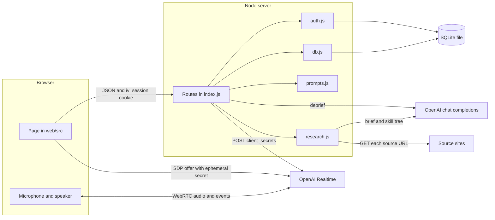
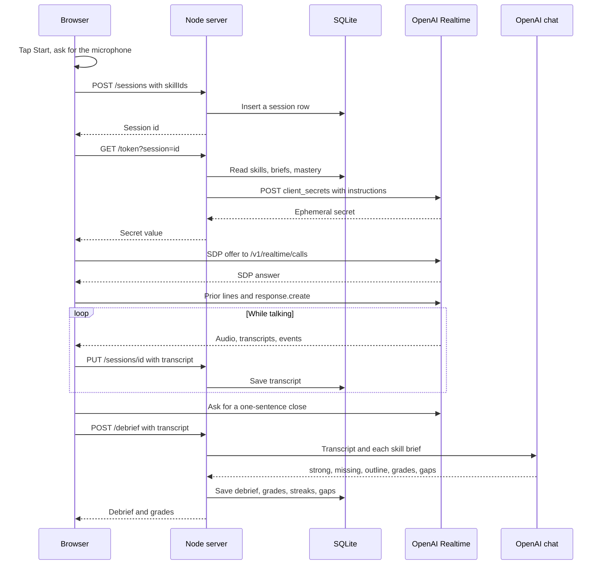
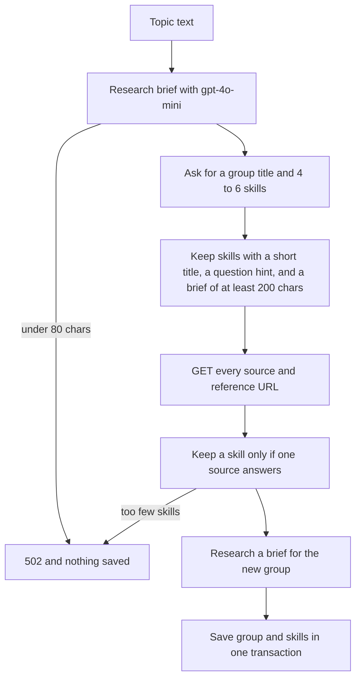
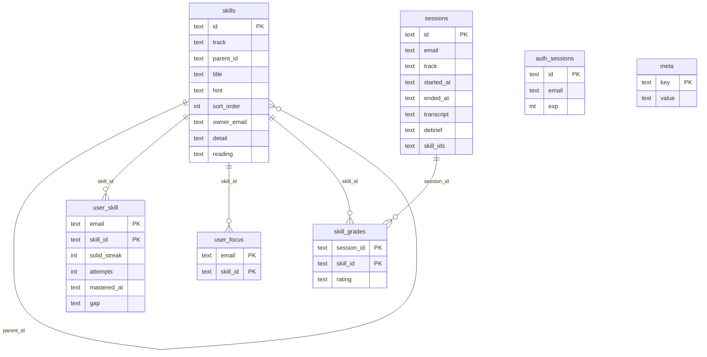

# Interview voice

A spoken mock interview for mid-level backend systems and AI engineering. You check the skills you want to practice, talk to an OpenAI Realtime interviewer in the browser, and get a written debrief that grades each skill and records what was missing.

One email and one passphrase can sign in. The OpenAI key stays on the Node server. Audio goes from the browser straight to OpenAI and is never stored. Transcripts, debriefs, grades, and skill briefs are stored in SQLite.

## Contents

- [Requirements](#requirements)
- [Setup](#setup)
- [Run locally](#run-locally)
- [How it works](#how-it-works)
- [A practice session, step by step](#a-practice-session-step-by-step)
- [Skills, briefs, and mastery](#skills-briefs-and-mastery)
- [Adding a topic](#adding-a-topic)
- [Sign-in and security](#sign-in-and-security)
- [HTTP API](#http-api)
- [Data model](#data-model)
- [Limits](#limits)
- [Project layout](#project-layout)
- [Deploy on Fly](#deploy-on-fly)
- [GitHub](#github)

## Requirements

- Node.js 22 or newer. The server uses the built-in `node:sqlite` module. There is no SQLite package in `package.json`, and none should be added.
- An OpenAI API key that can use `gpt-realtime-2.1`, `gpt-4o-mini-transcribe`, and `gpt-4o-mini`.
- A browser with a microphone. Browsers allow the microphone only on `localhost` or HTTPS.

The only npm dependency is Vite, used to build the page.

## Setup

```bash
./setup.sh
```

`setup.sh` checks for Node 22 or newer, runs `npm ci`, and creates `.env` from `.env.example` if `.env` is missing. It fills `SESSION_SECRET` with a random value and leaves the rest empty. An existing `.env` is left unchanged.

Fill in `.env`:

| Variable | Required | Used for |
| --- | --- | --- |
| `OPENAI_API_KEY` | Yes | Realtime client secrets, debriefs, and topic research |
| `ALLOWED_EMAIL` | Yes | The only email that can sign in. Compared in lowercase |
| `APP_PASSPHRASE` | Yes | The password checked together with that email |
| `SESSION_SECRET` | Yes | Must be set before sign-in is enabled. Sessions themselves are random IDs stored in SQLite |
| `DATABASE_PATH` | No | SQLite file. Defaults to `data/interview.db` |
| `PORT` | No | Server port. Defaults to `8787`. The Docker image sets `8080` |
| `NODE_ENV` | No | `production` adds the `Secure` cookie flag and HSTS. The Docker image sets it |

The server reads `.env` on startup. A variable already set in the environment wins over the file. If any of the three sign-in values is missing, `POST /login` returns `503 Sign-in is not configured`.

`.env`, `data/`, `node_modules/`, and `web/dist/` are gitignored.

## Run locally

There are two ways to run it.

**Built page, one process.** This is closest to production.

```bash
npm run build
npm run server
```

Open http://127.0.0.1:8787. The server serves `web/dist` and the API from the same port. Run `npm run build` again after changing anything in `web/`. Restart the server after changing anything in `server/`.

**Vite dev server, two processes.** Use this while editing the page.

```bash
npm run server   # terminal 1, API on :8787
npm run dev      # terminal 2, page on :5173
```

Open http://localhost:5173. Vite reloads the page on save and proxies `/login`, `/logout`, `/me`, `/skills`, `/sessions`, `/token`, and `/debrief` to port 8787.

On first start the server creates the database file and its directory, creates the tables, and writes the built-in skill titles and opening questions. A new database has no briefs. See [Skills, briefs, and mastery](#skills-briefs-and-mastery).

## How it works



The browser and the server split the work this way:

- The **page** (`web/src/main.js`) holds the skill tree, the conversation view, and the past-sessions list. It sends JSON to the server with the `iv_session` cookie.
- **`web/src/session.js`** opens the microphone, gets a short-lived secret from `/token`, and opens a WebRTC call directly to `https://api.openai.com/v1/realtime/calls`. Audio and Realtime events never pass through Node.
- **`server/index.js`** is a plain `node:http` server. It checks the cookie on every API route, calls OpenAI, serves `web/dist`, and adds security headers.
- **`server/prompts.js`** only builds text. It turns the chosen skills and their briefs into Realtime instructions and does not touch the database.
- **`server/research.js`** calls chat completions and checks source links. It returns a branch of skills, and the route saves it through `db.js`.
- **`server/db.js`** owns every SQL statement. **`server/auth.js`** reads and writes the `auth_sessions` table.

## A practice session, step by step



1. **Start.** The whole blue circle is the Start button. The tap asks for the microphone immediately, which mobile Safari requires, and then creates the session with `POST /sessions`. Without any checked skill, the page says "Choose at least one skill."
2. **Instructions.** `/token` loads the session's skills. Mastered skills move to the end. `instructionsForSkills` lists only the unmastered ones, or all of them when every one is mastered. Each skill contributes its title, its opening question, and up to 1,500 characters of its brief. The interviewer is told to treat the brief as the syllabus, stay on a skill until the answer covers what the brief calls solid, and never read links aloud.
3. **Realtime session.** The server asks OpenAI for a client secret with model `gpt-realtime-2.1`, voice `marin`, transcription `gpt-4o-mini-transcribe`, and `semantic_vad` turn detection. Only the secret returns to the browser.
4. **Call.** The browser posts its SDP offer to OpenAI using that secret and opens the `oai-events` data channel. A new session gets "greet and ask the first question." A resumed session first replays the last 40 transcript lines, then gets "continue, do not greet."
5. **During the call.** The circle scales with mic or playback level and changes color while the interviewer speaks. Finished lines from both sides are appended to the transcript and saved 700 ms after the last change. Mute disables the microphone track.
6. **End.** End, or the 20-minute limit, asks the interviewer for a one-sentence close, waits 2.5 seconds, closes the call, saves the transcript as ended, and posts it to `/debrief`.
7. **Debrief.** `gpt-4o-mini` in JSON mode receives the transcript and each skill's brief. It returns what was strong, what was missing, a tighter outline, a grade of `solid`, `partial`, or `miss` for each skill the transcript covered, and a one-sentence gap note for every partial or miss. The server stores all of it and updates mastery.

Past sessions appear newest first: in a left column on a wide screen and in a horizontal strip below 720px. Opening one loads its transcript and debrief. Start then reads **Continue** and resumes that session.

## Skills, briefs, and mastery

There are three trees:

| Tree | Source | Contents |
| --- | --- | --- |
| Backend systems | `server/skills.js` | 5 groups, 15 skills: APIs, data stores, concurrency, reliability, scaling |
| AI engineering | `server/skills.js` | 5 groups, 15 skills: RAG, agents, evals, latency and cost, production failures |
| Yours | SQLite, per email | Topics added from the page |

Each skill has:

- a **title**
- a **hint**, which is the interviewer's opening question
- a **brief** (`detail`), up to 4,500 characters on what must be known, how it fails, and what a solid answer includes
- **reading**, which is the `sources` and `references` lists, each item `{ title, url }`

On every start the server upserts the built-in titles and hints. It never overwrites a stored brief or reading list. Briefs for built-in skills exist only in the database, so a new database has none until they are researched. Without a brief, the interviewer works from the opening question alone, and the debrief grades against less.

On the Skills screen, **Read** under a group or skill opens its brief, sources, and references. Checking a group checks all of its skills. The checked set is saved to `user_focus`, so it returns after a reload.

Mastery comes from debrief grades (`nextProgress` in `db.js`):

| Grade | Solid streak | Mastered | Gap note |
| --- | --- | --- | --- |
| `solid` | +1 | Yes once the streak reaches 2 | Cleared |
| `partial` | Reset to 0 | Cleared | Set from the debrief |
| `miss` | Reset to 0 | Cleared | Set from the debrief |

A skill row shows Untouched, In progress, or Mastered, plus the streak and the latest gap note. A group row counts mastered skills, skills in progress, and gaps.

## Adding a topic

Type a topic in **Add a topic** to create a new group under Yours. Use **Add to this group** inside one of your groups to add more skills to it. The request takes a while because research does several model calls and link checks before anything is saved.



- A link counts as live when it answers below 400, or with 401, 403, 405, or 429. Those four usually mean the site blocks bots and the page still exists. Each check has an 8-second timeout.
- A new group needs at least 4 surviving skills. Adding to a group needs at least 3.
- If the group-level brief fails, the group is still saved without its own brief.
- Each model call has a 45-second timeout and is retried once if the request itself fails.
- Your own groups and skills can be renamed or removed. Removing a group removes its skills, their progress, and their checked state.

## Sign-in and security

- `POST /login` compares email and passphrase as SHA-256 digests with `timingSafeEqual`.
- A successful sign-in stores a random 32-byte session ID in `auth_sessions` with a 12-hour expiry and sets the `iv_session` cookie: `HttpOnly`, `SameSite=Lax`, `Path=/`, and `Secure` in production.
- Sessions survive a server restart, and several devices can stay signed in at once. Expired rows are removed on the next sign-in. A session for an email that no longer matches `ALLOWED_EMAIL` is rejected and deleted.
- A rejected request while adding a topic returns the page to the sign-in form with "Sign in again."
- Every response carries `X-Content-Type-Options`, `X-Frame-Options: DENY`, `Referrer-Policy: no-referrer`, a `Permissions-Policy` allowing only this site's microphone, and a Content Security Policy that permits network calls only to this server and `https://api.openai.com`. HSTS is added in production.
- Every session and custom skill query is scoped to the signed-in email.
- The browser receives only the short-lived Realtime secret and never the API key.

## HTTP API

All routes except `/login` and static files need the `iv_session` cookie. Errors are JSON `{ "error": "..." }`.

| Method | Path | Does |
| --- | --- | --- |
| `POST` | `/login` | `{ email, passphrase }`. Sets the cookie |
| `POST` | `/logout` | Deletes the session row and clears the cookie |
| `GET` | `/me` | Returns `{ email }` or 401 |
| `GET` | `/skills` | All three trees with progress, checked state, briefs, and reading |
| `PUT` | `/skills/focus` | `{ ids }`. Saves the checked skills |
| `POST` | `/skills/topics` | `{ topic, groupId? }`. Researches and saves skills. Returns 201 with the trees |
| `PATCH` | `/skills/:id` | `{ title }`. Renames one of your skills |
| `DELETE` | `/skills/:id` | Removes one of your skills or groups |
| `GET` | `/sessions` | Your sessions, newest first, with a preview line |
| `POST` | `/sessions` | `{ skillIds }`. Creates a session |
| `GET` | `/sessions/:id` | Transcript, debrief, skill IDs, and grades |
| `PUT` | `/sessions/:id` | `{ transcript, ended }`. Saves the transcript |
| `DELETE` | `/sessions/:id` | Deletes the session and its grades |
| `GET` | `/token?session=:id` | Returns `{ value, expires_at }`, the Realtime secret |
| `POST` | `/debrief` | `{ transcript, sessionId }`. Writes the debrief and applies grades |

Any other `GET` serves a file from `web/dist`. Paths without a file extension fall back to `index.html`.

## Data model



- `skills` holds both built-in and custom rows. Built-in IDs look like `backend.apis.contracts`. Custom IDs are `c` followed by 16 hex characters, with `owner_email` set and `track = 'yours'`. `reading` is JSON text.
- `sessions.transcript`, `debrief`, and `skill_ids` are JSON text. Session IDs are 32 hex characters. `track` is `backend`, `ai`, `yours`, or `mixed`.
- The database runs in WAL mode, so `interview.db-wal` and `interview.db-shm` appear next to it. Back up all three, or run `PRAGMA wal_checkpoint(TRUNCATE)` first and copy the single file.
- Missing columns are added at startup. An old `data/sessions.json` is imported once and marked done in `meta`.

## Limits

| What | Limit |
| --- | --- |
| Sign-in attempts | 8 per 15 minutes per IP |
| Interview starts (`/token`) | 12 per hour per IP |
| Debriefs | 8 per hour per IP |
| New topics | 8 per hour per email |
| Session length | 20 minutes, enforced in the browser |
| Transcript stored | 80 lines, 2,000 characters each |
| Lines replayed on resume | Last 40 |
| Brief sent to Realtime and to the debrief | 1,500 characters per skill |
| Transcript sent to the debrief | 20,000 characters |
| Request bodies | 2 KB sign-in, 4 KB topic, 8 KB session and focus, 64 KB transcript |

Rate limits live in memory and reset when the server restarts. Behind Fly they use the `Fly-Client-IP` header.

## Project layout

```
server/
  index.js      HTTP server, routes, OpenAI calls, static files, headers
  auth.js       passphrase check, session cookie, rate limits
  db.js         SQLite schema, migrations, skills, sessions, grades
  skills.js     built-in tree: titles and opening questions
  prompts.js    Realtime instructions from skills and briefs
  research.js   topic research and source link checks
web/
  index.html    sign-in, past sessions, skills, conversation
  src/main.js   page state, skill tree, sessions, debrief
  src/session.js  microphone, WebRTC call, audio level
  src/style.css   light theme, layout, phone layout under 720px
  vite.config.js  dev server on 5173 and API proxy
setup.sh        first-time install and .env
Dockerfile      two-stage build, runs on port 8080
fly.toml        Fly app, volume at /data
docs/GITHUB.md  publishing steps
```

## Deploy on Fly

`fly.toml` describes the app `interview-voice-sjp` in region `sin`:

- The Dockerfile builds the page in a `node:22-alpine` stage, then copies `server/` and `web/dist` into a second `node:22-alpine` image that runs `node server/index.js` with `NODE_ENV=production` and `PORT=8080`.
- The volume `interview_data` is mounted at `/data`, and `DATABASE_PATH` is `/data/interview.db`.
- Machines stop when idle and start on the next request. `min_machines_running` is 0. The VM is shared-cpu-1x with 1 GB.
- `.dockerignore` keeps `.env`, `data/`, `web/dist`, and Markdown out of the image.

Set the secrets on Fly, never in a tracked file:

```bash
fly secrets set OPENAI_API_KEY=... ALLOWED_EMAIL=... APP_PASSPHRASE=... SESSION_SECRET=...
flyctl deploy --ha=false
```

The image does not contain the local database. To move it to the volume, checkpoint it locally, upload it with `fly ssh sftp`, and restart the machine.

Current state: https://interview-voice-sjp.fly.dev runs on a trial account, which stops a machine after about five minutes. On 1 November 2026 the Singapore machine's host also became unreachable, and visits returned 503. Adding a card at https://fly.io/trial removes the five-minute stop. If the host stays unreachable, the machine and volume need replacing.

## GitHub

The repository is private at https://github.com/siddharth-jp-lab/interview-voice. `.github/workflows/build.yml` runs `npm ci` and `npm run build` on Node 22 for every push and pull request. It does not deploy and needs no secrets. Publishing steps are in [docs/GITHUB.md](docs/GITHUB.md).
